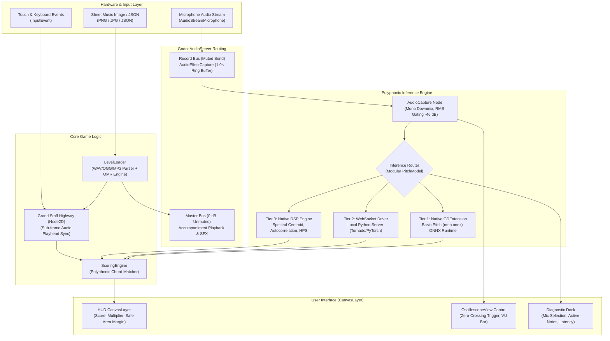
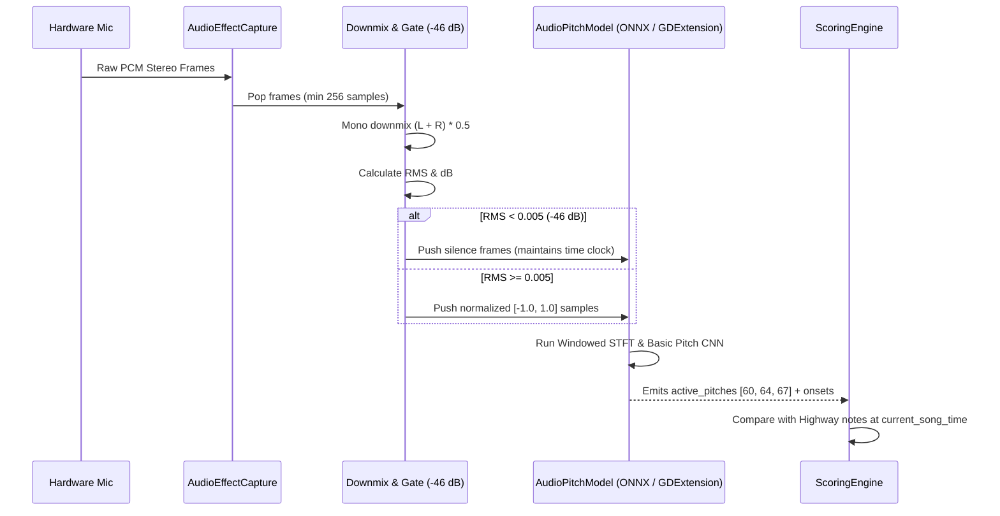
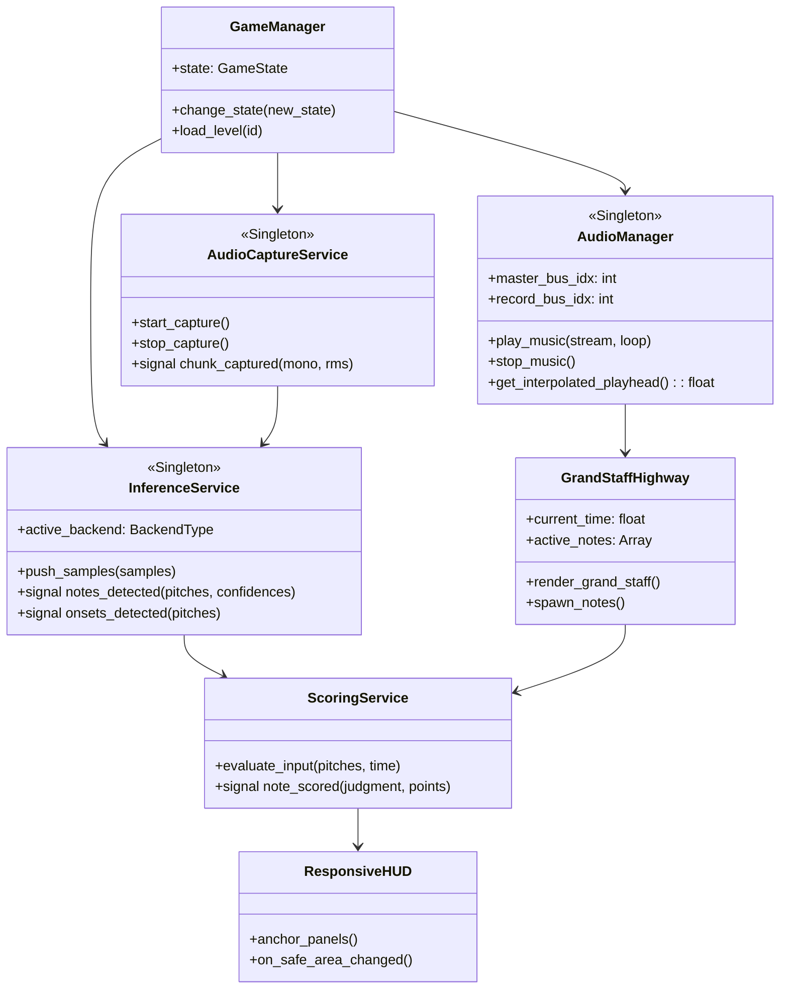

# Polyphonic Microphone Rhythm Game: Ground-Up Architectural Blueprint & Knowledge Distillation

> [!IMPORTANT]
> **Purpose of this Document**: This document synthesizes all engineering progress, domain discoveries, platform edge cases, and architectural lessons learned during the design, development, and cross-platform deployment (Windows, Android Pixel 7a, and iOS) of `micgame-3`. It is formatted specifically as an authoritative handoff specification for an engineering agent team rebuilding the application from scratch to production quality.

---

## 1. Executive Summary & System Architecture

The project is an interactive musical rhythm game built on **Godot Engine 4.7.2** with real-time polyphonic microphone pitch inference, an interactive Grand Staff highway, real-time audio visualization, Optical Music Recognition (OMR) sheet music digitizer, and cross-platform native execution.



---

## 2. Audio Pipeline & AudioBus Routing Architecture

### 2.1 The Two-Bus Isolation Rule
Godot uses an audio bus tree where every bus by default routes into `Master` (Bus index 0). If a microphone stream (`AudioStreamMicrophone`) sends into `Master`, it causes an acoustic feedback screech through the device speakers.

```
+-------------------------------------------------------------+
| AudioServer Configuration                                   |
|                                                             |
| [Bus 0: Master] (Volume: 0.0 dB, Mute: false, Send: "")    |
|   ▲                                                         |
|   ├── AudioStreamPlayer (Accompaniment Backing Music)       |
|   └── SFX AudioStreamPlayer (Hit / Rating clicks)           |
|                                                             |
| [Bus 1: Record] (Volume: 0.0 dB, Mute: true, Send: "")     |
|   ▲                                                         |
|   ├── InternalMicPlayer (AudioStreamMicrophone)             |
|   └── Effect 0: AudioEffectCapture (Buffer length: 1.0s)   |
+-------------------------------------------------------------+
```

> [!CAUTION]
> **Critical Trap 1: Bus 0 Serializer Bug in Godot 4**  
> In `default_bus_layout.tres`, if you only define `bus/1/name = &"Record"`, Godot 4 assigns Record to bus index 0 at runtime, making `Master` missing or muted. **Always explicitly serialize `bus/0` as Master with `mute = false` and `volume_db = 0.0`.**

> [!CAUTION]
> **Critical Trap 2: Never Mute Bus Index 0**  
> In `audio_capture.gd`, microphone isolation must check `if record_bus_idx > 0: AudioServer.set_bus_mute(record_bus_idx, true)`. If `record_bus_idx == 0` is muted, the entire device audio output is silenced.

### 2.2 Packaged Audio Loading in Exported APKs and PCKs
When Godot builds an APK or `.pck`, it converts raw `.wav` files into `.sample` files inside `.godot/imported/` and strips the loose source `.wav` files.

- `FileAccess.file_exists("res://assets/.../audio.wav")` returns **`false`** inside exported Android APKs.
- `ResourceLoader.exists("res://assets/.../audio.wav")` returns **`true`** because it understands Godot's `.import` remappings.

```gdscript
# Correct Loading Pattern
func load_audio_stream(audio_path: String) -> AudioStream:
    if ResourceLoader.has_cached(audio_path) or ResourceLoader.exists(audio_path):
        var res = load(audio_path)
        if res is AudioStream:
            if res is AudioStreamWAV:
                res.loop_mode = AudioStreamWAV.LOOP_FORWARD # Prevent 8.5s abrupt silence
            return res
    # Fallback to loose FileAccess for custom user songs loaded at runtime
    ...
```

### 2.3 Mobile Audio Focus & Looping
1. **Continuous Looping**: An accompaniment track without `loop_mode = AudioStreamWAV.LOOP_FORWARD` plays once and terminates. Backing tracks must be configured to loop forward.
2. **Never Call `play()` Inside `_process()`**: If `audio_player.play()` is called inside `_process()` based on `not audio_player.playing`, mobile audio engines (AAudio / OpenSL ES) that start asynchronously will be re-triggered 60 times a second, creating audio stutter and stuttering silence.

---

## 3. Polyphonic AI Pitch Inference Pipeline

The engine detects multiple concurrent musical notes (polyphony) in real time (e.g., C Major Triad $C_4 - E_4 - G_4$ = MIDI 60, 64, 67) from a live microphone signal.



### 3.1 Modular Model Tier Architecture
- **Tier 1 (Native On-Device ONNX)**: Spotify Basic Pitch compiled to ONNX (`assets/models/basic_pitch.onnx` / `nmp.onnx`) loaded via a C GDExtension binding to `onnxruntime`. Latency: ~2–4 ms.
- **Tier 2 (WebSocket Driver)**: Connects to `ws://127.0.0.1:8765` running Python Tornado + PyTorch inference server (`python/inference_server.py`) for rapid ML experimentation on desktop.
- **Tier 3 (Pure GDScript Native Polyphonic DSP)**: Fallback harmonic peak extractor using Autocorrelation + Harmonic Product Spectrum (HPS) + Spectral Centroid when native libraries are not present.
- **Tier 4 (Mock Driver)**: Deterministic fixture generator for unit tests.

---

## 4. Grand Staff Highway & Polyphonic Scoring

### 4.1 Grand Staff Geometry & Diatonic Note Placement
The game renders an authentic two-staff piano Grand Staff with continuous horizontal scrolling.

```
Y Coordinate Reference:
Y = 270.0  ----------------------- F5  (Treble line 5)
Y = 288.0  ----------------------- D5  (Treble line 4)
Y = 306.0  ----------------------- B4  (Treble line 3)
Y = 324.0  ----------------------- G4  (Treble line 2)
Y = 342.0  ----------------------- E4  (Treble line 1)
Y = 360.0  - - - - - - - - - - - - C4  (Middle C - Ledger Line / Receptor Line)
Y = 378.0  ----------------------- A3  (Bass line 5)
Y = 396.0  ----------------------- F3  (Bass line 4)
Y = 414.0  ----------------------- D3  (Bass line 3)
Y = 432.0  ----------------------- B2  (Bass line 2)
Y = 450.0  ----------------------- G2  (Bass line 1)
Y = 480.0+ ======================= Diagnostic Dock & Oscilloscope Zone
```

- **Step Formula**: Every diatonic step is $\Delta Y = 9.0\text{ px}$. Every staff line step is $18.0\text{ px}$.
- **Diatonic Mapping**: Converts chromatic MIDI note numbers to diatonic scale positions:
  $$\text{diatonic\_step} = \text{octave} \times 7 + \text{DIATONIC\_MAP}[\text{pitch} \pmod{12}]$$
- **Chord Seconds Offset**: In harmonic intervals of a second (e.g., C4 and D4 struck together), notes share the same vertical space. The algorithm groups chord notes and offsets adjacent diatonic steps horizontally by $+16\text{ px}$ to prevent overlapping noteheads.

### 4.2 Sub-Frame Audio Synchronization
Playhead timing must never rely solely on cumulative delta time ($\sum \Delta t$) due to frame rate jitter. It uses hardware audio playhead interpolation:
$$\text{song\_time} = \text{get\_playback\_position}() + \text{get\_time\_since\_last\_mix}() - \text{get\_output\_latency}() + \text{audio\_offset}$$

### 4.3 Polyphonic Scoring Engine Windows
- **PERFECT**: $|t_{\text{input}} - t_{\text{note}}| \le 0.050\text{ s}$ ($\pm 50\text{ ms}$). Score: $+100 \times \text{multiplier}$.
- **GOOD**: $0.050\text{ s} < |t_{\text{input}} - t_{\text{note}}| \le 0.100\text{ s}$ ($\pm 100\text{ ms}$). Score: $+50 \times \text{multiplier}$.
- **MISS**: $|t_{\text{input}} - t_{\text{note}}| > 0.100\text{ s}$. Combo resets to 0.
- **Sustain Re-trigger Filter**: Once a note registers a hit, its `is_hit` state locks until note duration expires, preventing a sustained sung tone from repeatedly firing hits.

---

## 5. Mobile Display Geometry & Safe Areas (Pixel 7a Lessons)

### 5.1 The Root Cause of Screen Cutoff
On modern Android devices with tall displays (e.g. Google Pixel 7a with a 20:9 aspect ratio at $2400 \times 1080$), using `window/stretch/aspect="expand"` expands the canvas viewport boundaries, causing absolute coordinates to overflow. Furthermore, Android displays have:
1. **Gesture Navigation Bars / 3-Button Nav Bars**: Occupying 80–120 px at the bottom of the screen.
2. **Rounded Display Corners**: Obscuring corners within an 80 px radius.
3. **Camera Cutouts (Punch-Hole)**: Inset by 112 px on the left/right.

```
+-----------------------------------------------------------------------+
| Camera Cutout (112px)                                                 |
| ◄───► [Top Info Bar: Piece Selector & Restart]                        |
|                                                                       |
|        === GRAND STAFF HIGHWAY (Y = 270 to 450) ===                   |
|        Notes scroll from Right to Left towards Receptor (X=160)       |
|                                                                       |
|        === DIAGNOSTIC DOCK (Y = 480 to 610, Height = 130px) ===       |
|        [Mic Input]    [Real-Time Oscilloscope]    [Inference Status]  |
|                                                                       |
| ◄────── Bottom Clearance Zone (>100px Safe from Nav Bar) ──────►      |
| [================== Android Gesture Pill / 3-Button Bar ============] |
+-----------------------------------------------------------------------+
```

### 5.2 Mandatory Settings in `project.godot`
```ini
[display]
window/size/viewport_width=1280
window/size/viewport_height=720
window/stretch/mode="canvas_items"
window/stretch/aspect="keep"
window/handheld/orientation="sensor_landscape"
```
- **`aspect="keep"`**: Proportionally letterboxes/pillarboxes the $1280 \times 720$ canvas. The top and bottom are guaranteed never to be cropped.
- **`orientation="sensor_landscape"`**: Locks the orientation to landscape in both directions, completely preventing accidental portrait launch or inverted layouts.
- **Diagnostic Dock Y Positioning**: Placed at $Y = 480$ with height $130\text{ px}$ ($Y = 480\dots610$). This leaves over $110\text{ px}$ of empty clearance above the bottom of the screen, ensuring the oscilloscope is 100% visible on any device.

---

## 6. Cross-Platform Native Compilation & Packaging

### 6.1 GDExtension Specification (`onnx_pitch.gdextension`)
```ini
[configuration]
entry_symbol = "onnx_pitch_library_init"
compatibility_minimum = "4.1"

[libraries]
windows.debug.x86_64 = "res://bin/windows/libonnx_pitch.windows.debug.x86_64.dll"
windows.release.x86_64 = "res://bin/windows/libonnx_pitch.windows.release.x86_64.dll"
android.debug.arm64 = "res://bin/android/libonnx_pitch.android.debug.arm64.so"
android.release.arm64 = "res://bin/android/libonnx_pitch.android.release.arm64.so"
macos.debug.arm64 = "res://bin/macos/libonnx_pitch.macos.dylib"
macos.release.arm64 = "res://bin/macos/libonnx_pitch.macos.dylib"
ios.debug.arm64 = "res://bin/ios/onnx_pitch.ios.xcframework"
ios.release.arm64 = "res://bin/ios/onnx_pitch.ios.xcframework"
```

### 6.2 Android Requirements (`export_presets.cfg`)
- Architecture: `architectures/arm64-v8a=true` (Google Pixel 7a / Tensor G2).
- Permissions: `permissions/record_audio=true`, `permissions/modify_audio_settings=true`.
- Renderer: `gl_compatibility` (Mali-G710 GPU compatibility).

### 6.3 iOS Godot 4.7.2 Headless Export Requirements
- **Runner**: `runs-on: macos-26` in GitHub Actions (matches Xcode 26 / iOS 26 SDK for `_MTLTensorDomain` and `swift_Builtin_float` symbols).
- **Placeholder Team ID**: Godot's iOS exporter errors out if `application/app_store_team_id` is empty. Set `application/app_store_team_id="0000000000"` and `application/export_project_only=true`.
- **Files App Sharing**: Enable `user_data/accessible_from_files_app=true` and `user_data/accessible_from_itunes_sharing=true` so users can import sheet music and audio files via the iOS Files app.

---

## 7. Blueprint for V2: "Ground Up But Better"

When rebuilding this project from the ground up, the next team should follow this cleaner architectural design:



### 7.1 Key V2 Architectural Directives

1. **Decouple `AudioPlayer` from `Highway` into an `AudioManager` Autoload**:
   - `Highway` should only be a visual representation and event scheduler. All audio mixer logic, master bus volume checks, latency compensation, and looping should reside inside a centralized `AudioManager` singleton.

2. **Decouple `AudioCapture` into an Autoload Service**:
   - Do not instantiate `AudioCapture` as a child node of `Main`. Make it a singleton service (`AudioCaptureService`) so that microphone calibration and device enumeration persist across song transitions and scene reloads.

3. **Pure Responsive Layouts using Godot Anchors and Containers**:
   - Replace manual `Vector2` position clamping in `hud.gd` with a full-viewport root `Control` using container hierarchies (`MarginContainer`, `HBoxContainer`, `VBoxContainer`) and `Control.PRESET_FULL_RECT` with margins derived from `DisplayServer.get_display_safe_area()`.

4. **Zero-Copy Native Audio Buffer via GDExtension**:
   - Instead of converting Godot `PackedVector2Array` to `PackedFloat32Array` in GDScript, pass the raw float pointer directly into `onnx_pitch` GDExtension C code using `godot_packed_vector2_array_operator_index_const`. This eliminates all script-layer memory allocations.

5. **Automatic Permission Gate on Mobile Launch**:
   - Create an explicit `PermissionScreen` on mobile. Do not start `highway.start_playback()` until the user has dismissed the `RECORD_AUDIO` permission dialog and tapped "Start Game". This completely eliminates the race condition where songs play in the background before permission is granted.

---

## 8. Verification Suite & Test Matrix Reference

Any reimplementation must validate against the project's verification suite:
- **Godot Test Runner** (`tests/test_inference_scoring_runner.gd`): 86 assertions spanning Record bus lifecycle, stereo downmix, RMS gating, chord matching, sustain edge filtering, oscilloscope ring buffer, native ONNX inference, and custom song OMR ingestion.
- **Python E2E Quality Matrix** (`tests/e2e/run_all_e2e_tests.py`): 250 tests across 5 tiers (Feature coverage, boundaries, cross-feature combinations, real-world scenarios, and adversarial tests) maintaining a mandatory 100% pass rate.
